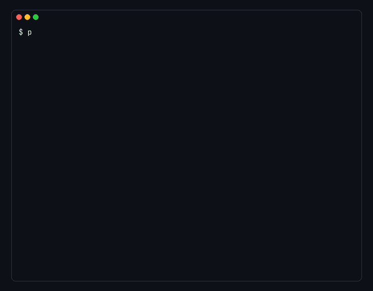

<p align="center">
  
</p>

<h1 align="center">NeuroBrix</h1>

<p align="center">
  <b>Run real AI models on the GPU you already own. No PyTorch required.</b><br/>
  Language, speech, image and video models from one engine and one container format.
</p>

<p align="center">
  <a href="https://pypi.org/project/neurobrix/"></a>
  <a href="https://github.com/NeuroBrix/neurobrix/blob/main/LICENSE"></a>
  <a href="https://neurobrix.org/models"></a>
  <a href="https://github.com/NeuroBrix/neurobrix/stargazers"></a>
  <a href="https://www.pythonweekly.com/p/python-weekly-issue-771-november-12-2026"></a>
</p>

<p align="center">
  
</p>

```bash
pip install neurobrix                      # the Triton engine: no PyTorch (about 1.8 GB installed)
neurobrix import TinyLlama/TinyLlama-1.1B-Chat-v1.0 --accept-license
neurobrix run --model TinyLlama/TinyLlama-1.1B-Chat-v1.0 --prompt "Write a Python function that reverses a string."
```

## Why NeuroBrix

- **Your hardware, not a rented API.** NeuroBrix plans where each part of a model runs from the GPUs and memory it
  finds: one GPU, several GPUs, streamed through GPU memory, or offloaded to the host. A request that does not fit is
  refused with the figures, never silently degraded.
- **One engine for every family.** A mixture-of-experts language model, a speech recognizer and a video diffusion model
  run through the same engine from the same `.nbx` container: 49 models ready on the
  [hub](https://neurobrix.org/models), no pipeline per model.
- **No PyTorch underneath, if you want.** The Triton engine runs on [nbxtensor](https://github.com/NeuroBrix/nbxtensor),
  our tensor library, with kernel settings certified per GPU class against a float64 reference. The PyTorch engine runs
  the same container, so each can be checked against the other.

## Runs on hardware you own

| Hardware | Status |
|---|---|
| NVIDIA GPUs on Linux and Windows | Released; both engines. Our own test machines are V100s. |
| Mac GPUs (Metal) | Released; both engines (`python -m nbxtensor install-metal`). |
| CPU (x86-64) | Released (PyTorch engine). |
| Other GPUs | Experimental, not yet validated on hardware by our lab; reports welcome: [open an issue](https://github.com/NeuroBrix/neurobrix/issues). |

Three things to try, one command each:

```bash
neurobrix run --model hexgrad/Kokoro-82M --prompt "Hello from my own GPU." --output speech.wav   # text to speech
neurobrix run --model openai/whisper-large-v3-turbo --audio recording.wav                        # speech to text
neurobrix run --model ostris/Flex.1-alpha --prompt "a lighthouse at dusk" --output lighthouse.png  # text to image
```
<!-- Commands and flags from "## Usage by family" below (checked against 0.6.11, 2026-11-12). -->

If NeuroBrix runs a model for you, a ⭐ helps other people find it.

<p align="center">
  <a href="https://neurobrix.org/models">Hub</a> &nbsp;|&nbsp;
  <a href="https://docs.neurobrix.org">Documentation</a> &nbsp;|&nbsp;
  <a href="https://github.com/NeuroBrix/neurobrix/releases">Releases</a> &nbsp;|&nbsp;
  <a href="https://github.com/NeuroBrix/neurobrix/blob/main/CONTRIBUTING.md">Contributing</a> &nbsp;|&nbsp;
  <a href="https://gitlab.com/neurobrix/neurobrix">GitLab mirror</a>
</p>

---

## What NeuroBrix does

- **One engine and one container format for every family it runs.** A model is shipped as
  a `.nbx` container that holds its computation graph, its weights, the way its components
  connect, and its runtime defaults. The engine reads all of that from the container.
  There is no hand-written pipeline per model: the same runtime executes a mixture-of-experts
  language model, a speech recognizer, a text-to-speech model and a video diffusion model
  through a small set of generic execution flows (autoregressive decoding, iterative
  denoising, encoder-decoder, and others).
- **Two independent compute branches over the same container.** The default branch runs
  the graph through PyTorch (ATen, with cuDNN and cuBLAS on NVIDIA GPUs). The Triton branch
  (`--triton`) runs the same graph through nbxtensor, NeuroBrix's tensor library (its Triton kernels
  and its tensor type), instead of PyTorch's operator library. The branches share the container and the
  placement plan, not compute code, so one can be checked against the other.
- **Placement is computed, not configured.** NeuroBrix detects the machine's devices and
  memory and plans where each component runs: on one GPU, across several GPUs, streamed
  through GPU memory, or offloaded to host memory. `neurobrix run --explain-plan` prints the
  chosen plan and the alternatives it rejected, without loading the model.
- **A request that does not fit is refused with figures.** When the plan cannot hold a
  request on your hardware, NeuroBrix stops with an error that names what was needed and
  what was available, rather than silently degrading the output.

`.nbx` containers are produced from the original published weights by the project's build
toolchain. You do not need that toolchain to run models: `neurobrix import` downloads
ready-made containers from the hub.

---

## Install and first run

NeuroBrix needs Python 3.10 or newer. The current release is
**0.6.13** ([release notes](https://github.com/NeuroBrix/neurobrix/releases/tag/v0.6.13)).

It has two engines. The **Triton engine** (`--triton`) runs on
[nbxtensor](https://github.com/NeuroBrix/nbxtensor) and Triton and needs no PyTorch. The
**PyTorch engine** (`--compiled`) needs PyTorch, installed from the index that matches your
hardware. With no mode flag, a run takes the PyTorch engine where PyTorch is installed and the
Triton engine where it is not, and its launch line says which.

**Triton engine, NVIDIA GPU (Linux).** Install the NVIDIA driver, then:

```bash
pip install neurobrix
neurobrix doctor
```

and run; without PyTorch the run takes the Triton engine (`engine: triton (torch not installed)`).
The CUDA runtime library comes with nbxtensor; nothing else is needed.

**PyTorch engine, NVIDIA GPU (Linux).** Install the PyTorch CUDA build that your driver
supports (see the selector on [pytorch.org](https://pytorch.org/get-started/locally/)), then
NeuroBrix with its `pytorch` extra. `pip install torch` on its own pulls the default PyTorch
wheel from PyPI, which may be built for a CUDA version your driver or GPU cannot use; you would
then get an engine that silently runs on CPU.

```bash
pip install typing-extensions      # from PyPI first: the PyTorch index carries only its source
pip install torch --index-url https://download.pytorch.org/whl/<cuda-build>   # e.g. cu126
pip install "neurobrix[pytorch]"
neurobrix doctor
```

**NVIDIA V100 (Volta).** Current CUDA 13 builds of PyTorch no longer support Volta. Use a
`cu126` build. `torch 2.10.0+cu126`, `torch 2.14.0+cu126` and `torch 2.14.1+cu126` were checked
on the project's V100 machines. The default PyPI `torch` and the cu128, cu129, cu130 and cu132
builds were not usable there.

**Installed size**, measured on a clean `python:3.10-slim` container on 2026-11-06 (the space
the packages take in `site-packages`): `pip install neurobrix`, the Triton engine alone, 1.48 GiB
(nbxtensor, Triton, NumPy and the engine); with the PyTorch engine (`torch 2.14.1+cu126` from the
PyTorch index, then `neurobrix[pytorch]`) 6.82 GiB.

**Apple Silicon (macOS).** The Triton engine runs on the Apple GPU through Metal. PyPI publishes
no Triton for macOS: `install-metal` installs NeuroBrix's Triton build for Apple GPUs
([NeuroBrix/triton-ext](https://github.com/NeuroBrix/triton-ext); upstream:
[triton-lang/triton-ext#126](https://github.com/triton-lang/triton-ext/pull/126)), each wheel
checked against the sha256 written in nbxtensor (in 0.6.3: macOS 15 and CPython 3.12; macOS 14 and
CPython 3.10-3.13 by hand, see the known limits below):

```bash
pip install neurobrix
python -m nbxtensor install-metal
neurobrix doctor
```

Xcode's Metal toolchain is the other requirement (`neurobrix doctor` says when it is missing).
The PyTorch engine also runs on the Apple GPU, through MPS: `pip install torch "neurobrix[pytorch]"`.

**CPU only** (the PyTorch engine).

```bash
pip install torch --index-url https://download.pytorch.org/whl/cpu
pip install "neurobrix[pytorch]"
```

`neurobrix doctor` checks that the `neurobrix` command is on your PATH, whether the Triton
engine can run (nbxtensor, Triton and a GPU runtime), which PyTorch build is installed if any,
and whether it can see the GPUs your driver reports. It exits non-zero when neither engine can
run.

### First run

```bash
# Browse the hub and download a small language model
neurobrix hub --category LLM
neurobrix import TinyLlama/TinyLlama-1.1B-Chat-v1.0 --accept-license

# Run it once (hardware is detected automatically)
neurobrix run --model TinyLlama/TinyLlama-1.1B-Chat-v1.0 \
    --prompt "Write a Python function that reverses a string." --max-tokens 256
```

**One name per model.** A model is named by its hub name, `<org>/<name>` (its Hugging Face or vendor repository's).
`neurobrix import` records that name beside the installed model, and `--model` (`run`, `serve`, `upscale`), `remove`,
`neurobrix list` and the HTTP API all use it; there is no second, short name. A model installed before 0.6.3 keeps its
directory name until `neurobrix import <org>/<name>` is run once for it (nothing is downloaded again), and `list` and
every use say so in one line.

A run prints its result on stdout (the generated text, the transcript, or `SAVED: <path>` for a file) and a few
status lines on stderr: the engine in use and the run time, and on the very first run a line saying the machine is
being measured once for its hardware profile, with the time it expects. `-v` adds the engine's developer lines — the
plan, the loaders, the kernel directory, the timings — `-vv` the traceback of an error, and `NBX_LOG=debug` in the
environment both.

### Serve and chat

`neurobrix serve` keeps a model loaded in a background daemon between requests; `chat` talks to a language model
through it, `run` uses it when it serves the same model, and `stop` unloads it:

```bash
neurobrix serve --model TinyLlama/TinyLlama-1.1B-Chat-v1.0
neurobrix chat                       # interactive multi-turn chat (/new, /context, /status, /quit)
neurobrix run --prompt "Hello"       # --model can be omitted while a daemon is running
neurobrix stop                       # stop the daemon and free GPU memory
```

Whether the weights stay on the device between requests (warm) depends on the plan Prism chooses for the machine;
`serve` says which. Details: [Serving and chat](docs/serving.md).

### The conversation cache

The KV cache belongs to the chat session, on both engines. Each turn matches the conversation's token IDs against what
the cache already holds and prefills only the new ones (TinyLlama, a 421-token second turn: 158 positions prefilled
instead of 421). Prism chooses the session's prefill chunk from the certified kernel times (`--explain-plan` says
which, or why none); with that chunk, a turn served from the cache gives the same bytes as the same conversation
prefilled together.

A conversation has a ceiling, stated when `serve` starts ("served context: up to N positions a session"): the
positions the card's cache holds (`session_reach` in `run --explain-plan`) plus, past them, those the KV host tier's
share of host memory holds, within the model's window. A turn that would pass it is refused with that ceiling (over
HTTP: `400 context_length_exceeded`);
older turns are never summarised or dropped. `/context` in `chat` shows the conversation's exact token count, the
ceiling and the tokens the cache holds; `/new` starts again.

`run --turns` plays a JSON list of user messages as one session, through the same code the daemon runs, and prints
each answer with the tokens its turn matched and prefilled:

```bash
echo '["Name three primary colours.", "Which of them is the warmest?"]' > turns.json
neurobrix run --model TinyLlama/TinyLlama-1.1B-Chat-v1.0 --turns turns.json --max-tokens 64
```

### OpenAI-compatible API

`neurobrix serve --http` opens an HTTP server that speaks the OpenAI API on the same daemon: the same loaded model,
the same queue and the same inference thread as `chat` and `run`, so they share the warm weights.

```bash
neurobrix serve --model TinyLlama/TinyLlama-1.1B-Chat-v1.0 --http      # http://127.0.0.1:8765/v1
```

The address is `127.0.0.1:8765` unless `--http-host` / `--http-port` say otherwise; an address other than loopback
is refused without `--api-key-file <file>`, and every request then sends `Authorization: Bearer <key>`. The endpoints
served are those the loaded model's family has: `/v1/models`, `/v1/chat/completions` (streamed as Server-Sent Events,
tool calls parsed from the format the model's chat template declares, a thinking model's reasoning in
`reasoning_content`), `/v1/completions`, `/v1/images/generations`, `/v1/audio/speech` and
`/v1/audio/transcriptions`, and `/v1/embeddings` for an embedding family (none in the catalogue yet: refused by
name). The `model` field is the model's one name.

```bash
curl -s http://127.0.0.1:8765/v1/chat/completions -H 'Content-Type: application/json' -d '{
  "model": "TinyLlama/TinyLlama-1.1B-Chat-v1.0",
  "messages": [{"role": "user", "content": "What is a KV cache?"}], "max_tokens": 128}'
```

With the OpenAI Python client (`pip install openai` on the client side; the engine does not need it):

```python
from openai import OpenAI

client = OpenAI(base_url="http://127.0.0.1:8765/v1", api_key="unused")   # the key file's content when the server has one
model = client.models.list().data[0].id

for chunk in client.chat.completions.create(model=model, stream=True,
                                            messages=[{"role": "user", "content": "Tell me a story."}]):
    if chunk.choices and chunk.choices[0].delta.content:
        print(chunk.choices[0].delta.content, end="", flush=True)
```

A parameter the engine does not honour (`stop`, `logprobs`, `n` > 1, ...) is refused by name
in the OpenAI error object, never ignored. Every endpoint, parameter and setting: [Serving and chat](docs/serving.md).

---

## Hardware and modality coverage

### Hardware

| Hardware | Status |
|---|---|
| NVIDIA GPUs, Linux (CUDA) | Released in 0.6.0. Both compute branches. The project's own test machines are V100s. |
| CPU (x86-64) | Released in 0.6.0 (the PyTorch engine). |
| Apple Silicon (Metal) | In 0.6.0. Both engines: the Triton engine through Metal (NeuroBrix's Triton build for Apple GPUs, installed by `python -m nbxtensor install-metal`), the PyTorch engine on MPS. Install: [Install and first run](#install-and-first-run), Apple Silicon. |
| Intel GPUs | **Experimental, not yet validated on hardware by the NeuroBrix lab — reports welcome.** An Intel GPU whose Level Zero runtime is installed (Arc, Core Ultra, and Gen12: Tiger, Alder, Raptor Lake) is tried by the Triton engine, with Intel's Triton build (`neurobrix doctor` gives the install commands). If the driver says the chip cannot do what was asked (a kernel it will not build, an unsupported feature), the run says which call failed and why, runs again without that chip (on the CPU when it was the only device), and remembers it until the driver or nbxtensor changes; any other error is the run's own, named. Please tell us what happened: [Intel GPU report](https://github.com/NeuroBrix/neurobrix/issues/new?template=intel_gpu_report.yml). |
| AMD GPUs | A target, not yet validated on a card: the Triton engine reaches them through nbxtensor's HIP driver, with the vendor's runtime and its Triton build (`neurobrix doctor` gives the vendor's install commands). Tried it on your card? [Open an issue](https://github.com/NeuroBrix/neurobrix/issues). |
| Integrated GPUs | In 0.6.3. An integrated GPU is described in the machine's profile as one memory pool with the host and named with its platform. Apple Silicon is driven (Metal); an Intel integrated GPU with its Level Zero runtime is tried (experimental, the row above); AMD integrated GPUs and Intel chips older than Gen12 are not driven — they are named, with the reason, and the model runs on the CPU with every core of the machine's profile. |
| Windows | In 0.6.1. Both engines; the Triton engine needs the NVIDIA, AMD or Intel driver and the Triton build for your GPU (`neurobrix doctor` names what is missing). Found a bug on Windows? [Open an issue](https://github.com/NeuroBrix/neurobrix/issues). |

Several GPUs in one machine are used automatically when a model does not fit on one. The first launch names each GPU
from what the operating system ships (the PCI bus on Linux, Win32_VideoController on Windows), with its platform and
whether it is integrated. When a run meets a device out-of-memory in one of its components, it re-plans that
component with the memory it measured and goes on, once, keeping the components already finished.

**Known limits of 0.6.5:**

- On an Intel Mac the integrated GPU is named from system_profiler without its platform; it is not driven, and the
  engine runs on the CPU.
- Constrained decoding needs the grammar engine, the `nbxgrammar` package, which `pip install neurobrix` installs on
  Linux x86_64 and aarch64, macOS arm64 and x86_64 and Windows x86_64; on any other platform no wheel of it exists and a
  constrained request is refused by name (`501 constrained_decoding_not_installed`). It enforces a subset of JSON Schema (a
  constraining keyword outside it is refused by name) and writes tool calls in the format the model's template
  declares.
- No embedding model is in the catalogue yet: `/v1/embeddings` refuses every catalogue model by name.
- A very long single prompt on the compiled engine is prefilled in chunks of the rows the plan prices (128 for
  Qwen3-Coder-30B-A3B): it is answered, slowly — 79 931 tokens took 39 minutes on two V100-32GB.
- A daemon holds one model; a conversation past the card's cache spills to host memory one sequence at a time
  (batch 1).
- The macOS 14 Metal wheels (CPython 3.10-3.13) are published at
  [apple-v0.1.0+triton3.8.0-macos14](https://github.com/NeuroBrix/triton-ext/releases/tag/apple-v0.1.0%2Btriton3.8.0-macos14)
  and `python -m nbxtensor install-metal` selects them (since nbxtensor 0.0.9).

The full list is in the [release notes](https://github.com/NeuroBrix/neurobrix/releases/tag/v0.6.5). Read them
before filing a bug.

### Models on the hub

The hub listed 45 public models in 10 categories on 2026-10-12. The hub itself is the live
list (`neurobrix hub`, or [neurobrix.org/models](https://neurobrix.org/models)). Each
identifier below is what you pass to `neurobrix import`, and then to `--model`.

| Category | Models |
|---|---|
| Language models (`LLM`) | `TinyLlama/TinyLlama-1.1B-Chat-v1.0`, `ibm-granite/granite-3.1-1b-a400m-instruct`, `deepseek-ai/deepseek-moe-16b-chat`, `Qwen/Qwen3-30B-A3B-Thinking-2507` |
| Code (`CODE`) | `deepseek-ai/DeepSeek-Coder-V2-Lite-Instruct`, `Qwen/Qwen3-Coder-30B-A3B-Instruct` |
| Vision-language (`VLM`) | `zai-org/GLM-4.1V-9B-Thinking` |
| Multimodal (`MULTIMODAL`) | `deepseek-ai/Janus-Pro-7B`, `inclusionAI/Ming-Lite-Omni-1.5`, `openbmb/MiniCPM-o-4_5`, `Qwen/Qwen3-Omni-30B-A3B-Instruct`, `Qwen/Qwen3-VL-30B-A3B-Thinking` |
| Speech-to-text (`STT`) | `openai/whisper-large`, `openai/whisper-large-v3-turbo`, `nvidia/parakeet-tdt-1.1b` |
| Speech understanding (`AUDIO_LLM`) | `mistralai/Voxtral-Mini-3B-2507`, `nvidia/canary-qwen-2.5b`, `ibm-granite/granite-speech-3.3-8b` |
| Text-to-speech (`TTS`) | `hexgrad/Kokoro-82M`, `ResembleAI/chatterbox`, `microsoft/VibeVoice-1.5B`, `canopylabs/orpheus-3b-0.1-ft`, `fishaudio/s1-mini` |
| Image generation (`IMAGE`) | `ostris/Flex.1-alpha`, `PixArt-alpha/PixArt-XL-2-1024-MS` |
| Video generation (`VIDEO`) | `zai-org/CogVideoX-2b`, `zai-org/CogVideoX-5b-I2V`, `genmo/mochi-1-preview`, `hpcai-tech/Open-Sora-v2`, `rhymes-ai/Allegro`, `rhymes-ai/Allegro-TI2V`, `Efficient-Large-Model/SANA-Video_2B_720p_diffusers`, `Wan-AI/Wan2.1-T2V-1.3B-Diffusers`, `Wan-AI/Wan2.1-VACE-1.3B-diffusers`, `Wan-AI/Wan2.1-I2V-14B-480P`, `Wan-AI/Wan2.2-I2V-A14B` |
| Upscaling (`UPSCALER`) | Real-ESRGAN (x2, x4plus, x8), SwinIR (classical x2, x4), Swin2SR (classical x2, x4, real-world x4), HAT-L x4 |

A model being on the hub means its container can be downloaded. It does not mean every model
works on every hardware and in every execution mode; the release notes say which do not.

---

## Usage by family

The family is read from the container, so `run` takes the inputs that family needs. Every command and flag:
the [CLI reference](docs/reference/cli.md) (`neurobrix run --help` prints the same).

```bash
# Language model
neurobrix run --model TinyLlama/TinyLlama-1.1B-Chat-v1.0 --prompt "Explain recursion." \
    --temperature 0.7 --max-tokens 512 --output answer.txt

# Speech-to-text: audio in, text out
neurobrix run --model openai/whisper-large-v3-turbo --audio recording.wav

# Speech understanding: audio plus an instruction
neurobrix run --model mistralai/Voxtral-Mini-3B-2507 --audio meeting.wav \
    --prompt "Summarize this call."

# Text-to-speech
neurobrix run --model hexgrad/Kokoro-82M --prompt "Hello from NeuroBrix." --output speech.wav

# Vision-language: image plus a question
neurobrix run --model zai-org/GLM-4.1V-9B-Thinking --input-image photo.jpg \
    --prompt "What is in this image?"

# Multimodal models take --mode (text or image)
neurobrix run --model deepseek-ai/Janus-Pro-7B --mode text --input-image photo.jpg --prompt "Describe this image."
neurobrix run --model deepseek-ai/Janus-Pro-7B --mode image --prompt "a red apple on a wooden table"

# Image generation
neurobrix run --model ostris/Flex.1-alpha --prompt "a lighthouse at dusk" \
    --steps 20 --seed 42 --output lighthouse.png

# Video generation; --input-image switches an image-to-video model to its first frame
neurobrix run --model zai-org/CogVideoX-2b --prompt "a hot air balloon over mountains" \
    --num-frames 17 --seed 42 --output balloon.mp4

# Upscaling
neurobrix upscale --model xinntao/Real-ESRGAN-RealESRGAN_x4plus --input photo.png --output photo_x4.png
```

### Execution modes

| Flag | Branch | Use |
|---|---|---|
| `--compiled` | PyTorch | Normal use; the default where PyTorch is installed. |
| `--triton` | Triton | nbxtensor's Triton kernels instead of PyTorch's operator library; the default where PyTorch is not installed. |
| `--sequential` | PyTorch, one operation at a time | Debugging. |
| `--triton-sequential` | Triton, one operation at a time | Debugging. |

The same flags apply to `neurobrix serve`. `neurobrix upscale` takes them as
`--mode compiled|sequential|triton|triton-sequential`.

### Managing models

```bash
neurobrix hub [--category CATEGORY] [--search TERM]   # browse the hub
neurobrix import <org>/<name> [--no-keep] [--force]   # download and install
neurobrix list [--store]                              # installed models by name / downloaded archives
neurobrix remove <org>/<name> [--all]                 # remove from the cache (and the store)
neurobrix clean --all -y                              # remove everything
neurobrix info --models --hardware --system           # what is installed and detected
neurobrix inspect <name or model.nbx>                 # look inside a container
neurobrix validate <model.nbx>                        # check a container's integrity
```

Downloaded archives are kept in `~/.neurobrix/store/` and extracted models in
`~/.neurobrix/cache/`. `--no-keep` deletes the archive once it is extracted. Read commands
(`info`, `list`, `hub`, `inspect`, `doctor`, `run --explain-plan`) accept `--json` for
scripting.

### Certify your GPU and share it

nbxtensor's kernel settings, which the Triton engine runs, are certified per launch key (the kernel, its shape class
and dtypes) and per GPU class, against a float64 oracle, and shipped. A key your GPU class has
no certificate for is swept at run time and kept on your machine; certifying it makes it
permanent, and sharing it means nobody with your GPU sweeps it again. The four steps, with the
commands, are in nbxtensor's README,
[Certify your own hardware](https://github.com/NeuroBrix/nbxtensor#certify-your-own-hardware):

1. Run the models you use with `--triton`; the keys no certificate covers are swept and kept in
   `~/.neurobrix/replay_cache/`.
2. Certify them: `neurobrix autotune certify --profile <your device file> --keys <the kept keys> --out ./my-certificates`.
3. Check that they are served: the same run with `NEUROBRIX_AUTOTUNE_CERTIFIED_DIR=./my-certificates`
   and `--certified-only` says `0 swept at runtime` and gives the same output.
4. Share them: add the files under `src/neurobrix/config/autotune/<vendor>/<profile>/` and open
   a pull request with the
   [certificate template](./.github/PULL_REQUEST_TEMPLATE/certificate.md) (`?template=certificate.md`):
   your GPU, driver, the commands and the output of step 3.

Certified your GPU? Share your certificates — every class certified is a class nobody autotunes
again.

---

## The `.nbx` container

A container is a directory archive with a manifest, a topology describing how components
connect, runtime defaults, and one directory per component (text encoder, transformer, VAE,
language-model head, and so on), each with its computation graph and its weights in
safetensors format. Tokenizers and other non-neural modules travel in the same archive.
The format is described in [docs/architecture/nbx-format.md](./docs/architecture/nbx-format.md).

---

## Contributing

Bug reports, model requests, hardware reports and code are welcome. Read
[CONTRIBUTING.md](./CONTRIBUTING.md) first; it covers the development setup, the engine's
design rules (no hard-coded model values, no silent fallbacks, no model-specific logic in the
runtime) and the review process. Security issues follow [SECURITY.md](./SECURITY.md) and are
not filed as public issues.

- Issues and pull requests: [GitHub](https://github.com/NeuroBrix/neurobrix/issues), mirrored on
  [GitLab](https://gitlab.com/neurobrix/neurobrix)
- Model hub: [neurobrix.org/models](https://neurobrix.org/models)
- Documentation: [docs.neurobrix.org](https://docs.neurobrix.org) and the [docs/](./docs) directory
- The tensor library (nbxtensor) and its own documentation: [github.com/NeuroBrix/nbxtensor/tree/main/docs](https://github.com/NeuroBrix/nbxtensor/tree/main/docs)
- Building applications and coding agents: [docs/BUILD_WITH_AGENTS.md](./docs/BUILD_WITH_AGENTS.md)
- Roadmap: [docs/roadmap.md](./docs/roadmap.md)
- Changes: [CHANGELOG.md](./CHANGELOG.md)

---

## Model licenses

NeuroBrix runs models; it does not create, train or own them. Every model on the hub is the
work of its authors and stays under its original license, which the hub shows and which
`neurobrix import` asks you to accept. Some are restricted: for example `fishaudio/s1-mini`
is licensed CC-BY-NC-SA-4.0 (non-commercial use only). You are responsible for using each
model within its license. The hub's packages contain the original published weights
repackaged in the `.nbx` format. If you are a model author and believe a package does not
respect your license, open an issue on this repository.

## License

The NeuroBrix engine, CLI, runtime and container tooling are released under the
[Apache License 2.0](./LICENSE). The license does not cover model weights.

© 2025–2026 Hocine Benkelaya. NeuroBrix engine released under the Apache License 2.0.

Developed by Hocine Benkelaya · Supported and funded by [Neural Network Holding Ltd](https://neuralnetworkholding.com) · Commercial distribution by [WizWorks OÜ](https://wizworks.io).
