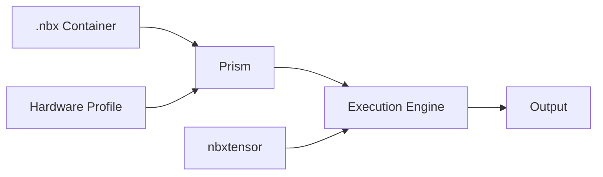

# Architecture

Technical deep-dives into how NeuroBrix works.

## Overview

NeuroBrix has three layers:

1. **NBX container**: a self-contained model archive (graphs, weights, topology, configs)
2. **Prism**: the planner. It reads the container and the machine's hardware profile and chooses where each
   part of the model runs
3. **Execution engine**: the graph runtime, with two branches. The PyTorch branch computes with PyTorch. The
   Triton branch computes with [nbxtensor](https://github.com/NeuroBrix/nbxtensor), NeuroBrix's own tensor
   library, with no PyTorch

All tensor logic lives in nbxtensor, never in the engine.

## Topics

- **[Runtime Engine](runtime.md)**: execution modes, Prism, flows, mixed precision, serving
- **[NBX Format](nbx-format.md)**: the model container
- **[Symbolic Shapes](symbolic-shapes-contract.md)**: how one graph serves many sizes
- **[ZERO Principles](zero-principles.md)**: the core design rules
